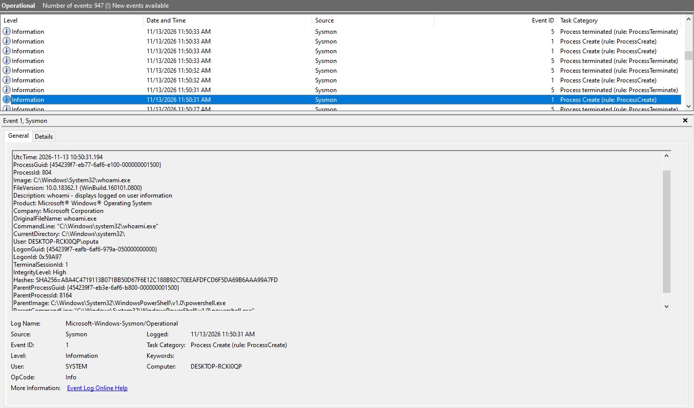
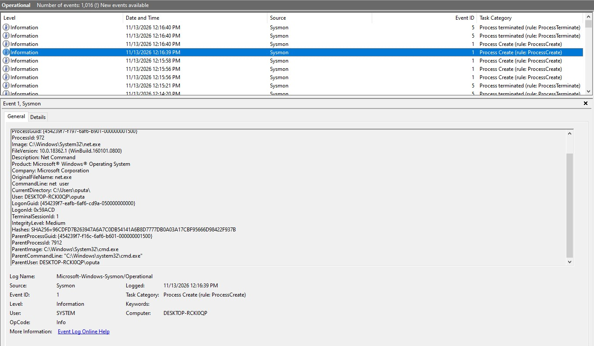
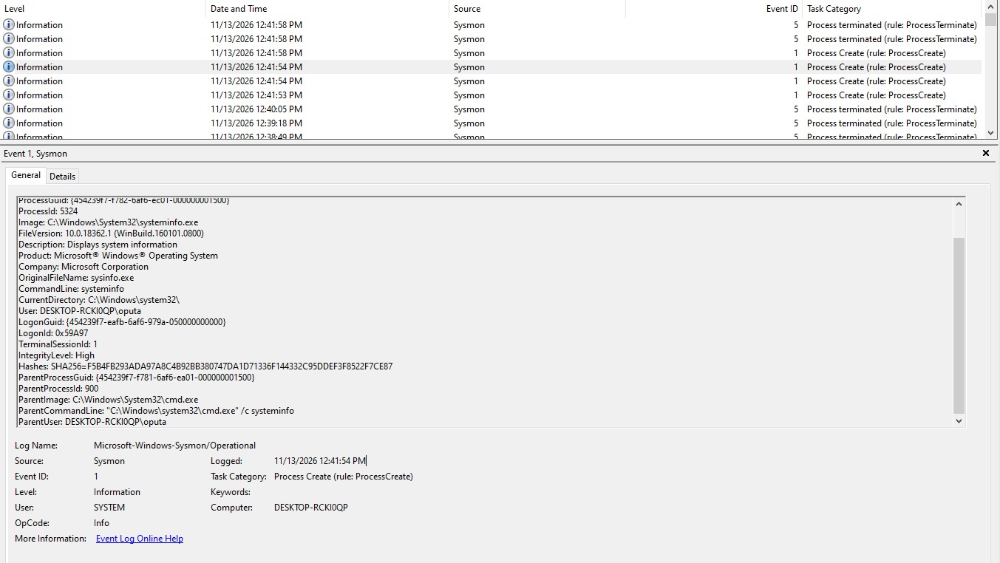
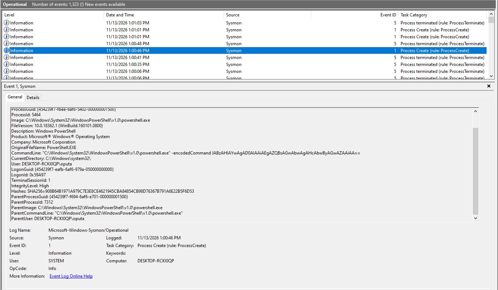
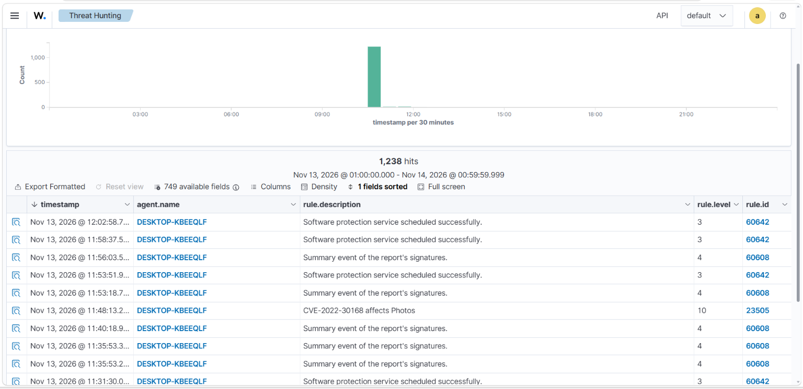

# Windows Threat Hunting & SIEM Ingestion Lab

A hands-on cybersecurity portfolio project demonstrating endpoint telemetry monitoring, threat hunting, and centralized log management.

---

## 🛠️ Tools & Environment
* **Endpoint:** Windows Virtual Machine (`DESKTOP-KBEEQLF`)
* **Telemetry & Logging:** Sysmon (System Monitor)
* **SIEM & Analytics:** Wazuh SIEM

---

## 🔍 Lab Evidence & Screenshots

### 1. PowerShell Execution Monitoring

*Capturing user context and process execution via Sysmon Event ID 1 (`whoami.exe`).*

### 2. Command Line Utility Execution

*Tracking built-in Windows utility execution (`net.exe`) for reconnaissance activity.*

### 3. System Information Enumeration

*Analyzing process lineage and command-line execution for system discovery (`systeminfo.exe`).*

### 4. PowerShell Script & Command Execution

*Monitoring PowerShell process execution and script parameters (`powershell.exe`).*

### 5. Wazuh SIEM Ingestion & Dashboard

*Real-time log ingestion, hit counters, and event timelines displayed on the Wazuh SIEM dashboard.*

---

## 📌 Conclusion
This project highlights practical threat hunting capabilities, endpoint visibility configuration, and incident analysis workflows essential for Security Operations Center (SOC) operations.
